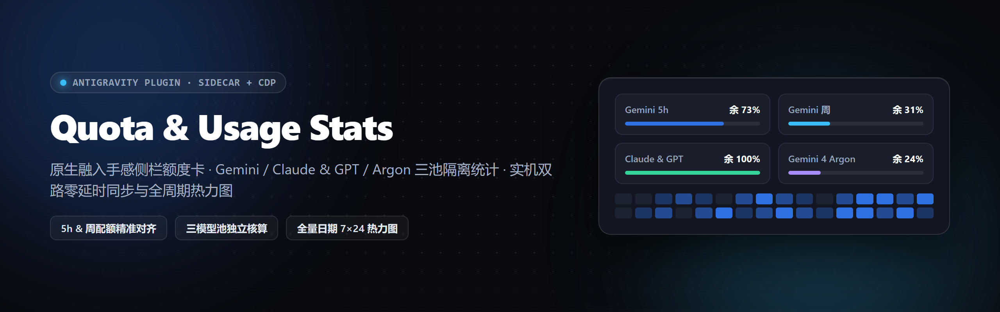
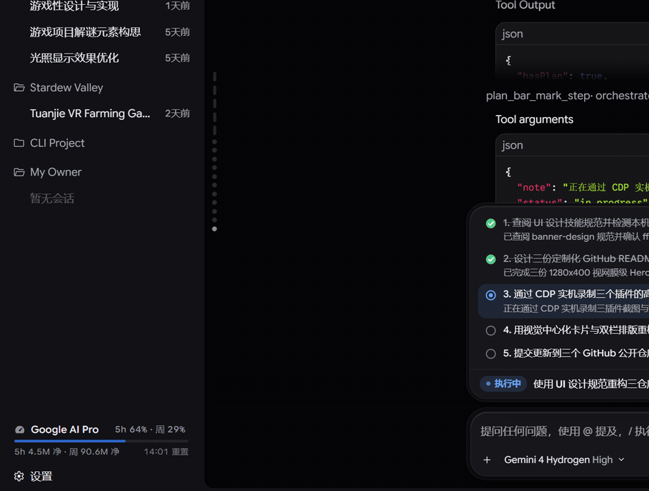
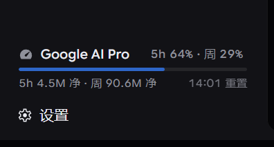
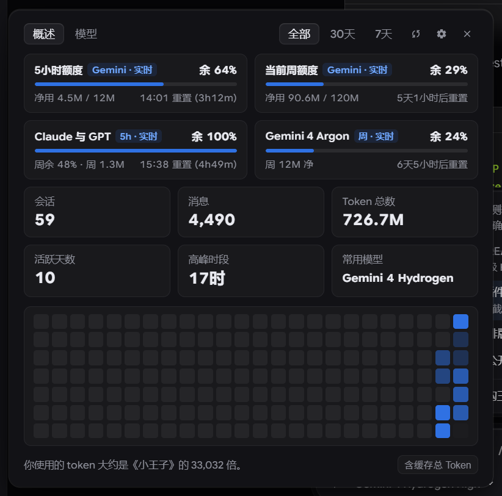
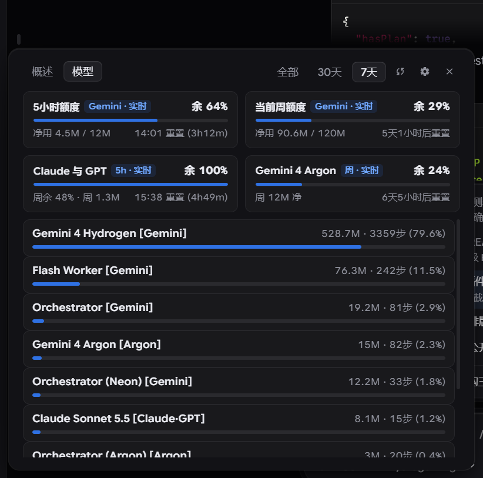

<div align="center">



<br /><br />

# Antigravity Quota &amp; Usage Stats

**原生融入手感的侧栏订阅额度卡 · 三大独立模型池精准隔离 · 实机双路零延时同步**

[](https://github.com/trrrrrryg/antigravity-quota-stats/releases)
[](#快速安装)
[](#仓库结构)

[实机演示](#实机演示) · [界面一览](#界面一览) · [核心机制](#核心机制) · [快速安装](#快速安装)

---

### 实机演示



<sub>无选中时背景与侧边栏完全融为一体；点击卡片弹出四池配额、KPI 与全量日期热力图，切换「7天 / 30天」时仅统计数值变动、下方 7×24 网格始终保留完整历史用量。</sub>

</div>

<br />

## 界面一览

<table>
  <tr>
    <td align="center" width="32%">
      <br />
      <strong>① 侧栏 Gemini 主卡</strong><br />
      <sub>默认无缝融入侧边栏；实时展示 Gemini 5h / 周余量与重置倒计时</sub>
    </td>
    <td align="center" width="34%">
      <br />
      <strong>② 四池配额 + 全量热力图</strong><br />
      <sub>独立隔离 Gemini、Claude &amp; GPT 与 Argon，一目了然各池余量</sub>
    </td>
    <td align="center" width="34%">
      <br />
      <strong>③ 模型调用池拆分明细</strong><br />
      <sub>每个模型精确标注所属池（<code>[Gemini]</code> / <code>[Argon]</code> / <code>[Claude·GPT]</code>）</sub>
    </td>
  </tr>
</table>

## 核心机制

| 维度 | 解决问题 | 实现方案 |
| :--- | :--- | :--- |
| **模型池精准隔离** | 避免 Claude、GPT、Argon（含编排器 Argon）Token 误算进 Gemini 主额度 | 在 `lib/proto.mjs` 与 `lib/stats.mjs` 中通过 `classifyModelPool()` 拆分为 `gemini`、`claude`、`argon` 三路独立计数 |
| **消除刷新慢一拍** | `modelOptions` 异步缓存有时滞后于官方 `RetrieveUserQuotaSummary` | 同一重置窗口内采用 `pickFresherBucket()` 取最低最新余量，并在本地步数增加或开启弹窗时主动防抖调用 `ctx.refreshModels()` |
| **全周期日期热力图** | 切换 `7天` / `30天` 时不丢失更早历史活跃日期 | 上方 KPI 与模型明细随选定区间筛选，下方 7×24 网格固定基于全量 `all` 数据绘制 |
| **0% 归零缺省兜底** | 额度耗尽时 Protobuf JSON 可能省略 `remainingFraction` | 当仅返回未来 `resetTime` 时自动判定剩余配额为 `0%`，不回退旧估值 |

## 快速安装

1. 确保 Antigravity 桌面端启动参数开启本地调试端口（在快捷方式目标末尾添加 `--remote-debugging-port=9222`）。
2. 从 [Releases](https://github.com/trrrrrryg/antigravity-quota-stats/releases) 下载 `antigravity-quota-stats-v1.0.0.zip` 并解压，或克隆至插件目录：
   ```bash
   git clone https://github.com/trrrrrryg/antigravity-quota-stats.git ~/.gemini/config/plugins/antigravity-quota-stats
   agy plugin validate ~/.gemini/config/plugins/antigravity-quota-stats
   agy plugin enable antigravity-quota-stats
   ```
3. 刷新或重启 Antigravity 后，左侧边栏底部 **设置** 上方即自动出现额度卡片。

<details>
<summary><strong>仓库结构与技术说明</strong></summary>

- `plugin.json`：插件元数据与技能声明
- `assets/logo.svg`：插件图标
- `lib/proto.mjs`：Protobuf 模型枚举识别、显示名映射与三池归类规则
- `lib/stats.mjs`：本地 SQLite 对话数据库与 Transcript 聚合统计引擎
- `sidecars/quota_bar/`：Sidecar 常驻进程（被动观测网络汇总 + CDP 热注入 Shadow DOM UI + 辅助网页面板）
- `skills/quota-stats/SKILL.md`：`/quota-stats` 快捷调用指南

</details>
